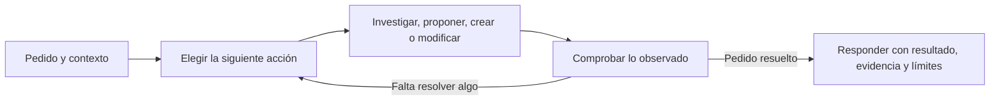

# lufy-ai

Lufy reúne políticas de trabajo, configuración y herramientas locales para desarrollar con IA en Codex. El agente principal conserva el contexto, lleva adelante el pedido y comprueba el resultado. Puede investigar, proponer, escribir, crear software, corregirlo o analizar datos según lo que necesites.

El flujo inline está integrado en `develop` y todavía no tiene release publicada. La última referencia estable, `v0.6.25`, pertenece al modelo anterior. Para usar el flujo actual, seguí la instalación desde el código de `develop` que se explica más abajo.

## Un flujo que se adapta al trabajo

Le pedís un resultado al agente. Este entiende el contexto y el alcance autorizado, elige la siguiente acción útil y usa lo que observa para decidir cómo continuar.



El orden y la profundidad cambian con la tarea. Un cambio pequeño puede resolverse directamente; un trabajo incierto puede necesitar una reproducción, una propuesta o una prueba exploratoria antes de implementar. Las decisiones se registran cuando ayudan a revisar o retomar el trabajo.

| Lo que pedís | Cómo se comprueba |
| --- | --- |
| Una explicación o investigación | Fuentes pertinentes, afirmaciones contrastadas y límites de la evidencia. |
| Una propuesta | Coherencia con la necesidad, alternativas, factibilidad y decisiones abiertas. |
| Una app nueva, funcionalidad o corrección | Comportamiento solicitado, integración y regresiones relevantes. |
| Una redacción o traducción | Fidelidad, exactitud, tono y formato. |
| Un análisis de datos | Procedencia, granularidad, consultas reproducibles y consistencia de resultados. |
| Una operación | Efecto autorizado y estado posterior observado. |

El principal puede usar TDD, memoria, contexto o revisión independiente cuando aporten valor. Una explicación termina al resolver la duda; una propuesta puede terminar sin implementación. El flujo no exige tiers, selección de metodología, documentos prefijados, scores ni una cadena de roles.

## Autonomía y colaboración

El agente resuelve los detalles técnicos dentro del pedido, comprueba su trabajo y comunica avances materiales. Consulta cuando falta una decisión de producto, alcance o acceso que no pueda resolver con las fuentes disponibles. Las actualizaciones de progreso permiten seguir el trabajo sin tener que aprobar cada paso.

La ejecución es `inline`: el principal mantiene la responsabilidad aunque colabore con otros agentes. `execution.delegation` define cuándo puede hacerlo:

- `off`: todo se resuelve en el principal.
- `on_request`: delega ante un pedido explícito del usuario.
- `auto`: puede delegar cuando aporte valor; es el default del producto.

El paralelismo requiere tareas independientes, ownership de archivos y una integración comprobable. El principal reúne los resultados y valida el conjunto. La configuración depende de herramientas reales del host; una instrucción de trabajar inline prevalece. Los permisos efectivos y el alcance autorizado se conservan al delegar.

Commit, push, PR, publicación y cambios externos requieren autorización explícita. Una autorización vigente permite continuar dentro de su alcance sin volver a pedirla por cada paso del proceso.

## Cómo se ve en un pedido

> Agregá un filtro por estado y conservá la paginación.

El agente inspecciona el comportamiento actual y sus dependencias, implementa el cambio y comprueba filtrado, paginación y casos relevantes. Si aparece una decisión que cambia la experiencia de uso, la consulta y continúa lo que no dependa de ella. Al terminar, explica qué quedó funcionando, cómo lo comprobó y qué sigue pendiente.

Si el pedido también incluye commit, push y PR, continúa con esa entrega y observa sus checks. Si pedís sólo analizar el problema, el resultado es un diagnóstico sustentado. Podés ver más ejemplos y criterios en [el flujo de trabajo](docs/harness-workflow.md).

## Empezar desde develop

Desde un checkout actualizado de `develop`, con Go según `tools/lufy-cli-go/go.mod`:

```sh
mkdir -p "$HOME/.local/bin"
go -C tools/lufy-cli-go build -o "$HOME/.local/bin/lufy-ai" ./cmd/lufy-ai
export PATH="$HOME/.local/bin:$PATH"
lufy-ai install --target /ruta/al/proyecto --tool codex --delegation off --dry-run
lufy-ai install --target /ruta/al/proyecto --tool codex --delegation off --yes
lufy-ai verify --target /ruta/al/proyecto --deep
```

El ejemplo elige `off` para trabajar completamente en el principal. Abrí el proyecto de destino en Codex y describí el resultado que necesitás. Las políticas, la configuración y las skills locales orientan al agente durante el trabajo.

El hook necesita `lufy-ai` en el PATH del host. Estos comandos corresponden a un proyecto nuevo o de la generación actual; revisá [instalación y recuperación](docs/installation.md) antes de reemplazar un ejecutable o estado existente. Los formatos del modelo anterior son incompatibles y no hay conversión automática.

## Herramientas que acompañan el flujo

- CLI Go para instalar, sincronizar, diagnosticar y recuperar assets con ownership, hashes y backups.
- Configuración de superficies, stacks y validaciones del proyecto.
- Memoria Obsidian portable, búsqueda de contexto lexical y cinco skills locales.
- Registros opcionales de comprobaciones, candidato Git, reviews y ejecuciones.

El catálogo actual es Codex project-local: 16 assets y un generador del bloque de `AGENTS.md`. Las observaciones y registros ayudan a inspeccionar el trabajo; la calidad se comprueba con evidencia pertinente al resultado. El [estado actual](docs/status.md) distingue capacidades disponibles y límites de los experimentos.

## Desarrollar Lufy

Los cambios al propio Lufy siguen este mismo enfoque: entender el problema, elegir una unidad revisable, implementar lo necesario y comprobar sus efectos. Una propuesta o un plan breve ayudan cuando hay incertidumbre o alcance amplio; los arreglos pequeños pueden resolverse directamente.

La base de trabajo es `develop`; `main` contiene la línea estable. Si cambia un asset distribuido, su fuente y mirror embebido deben quedar en paridad. La validación agrupada desde la raíz es:

```sh
scripts/validate.sh
```

Comprueba whitespace, workflows, scripts, paridad de assets, regresiones Python offline y la CLI Go con coverage, vet y build. Los ensayos con modelos se ejecutan por separado y requieren autorización. Consultá [contribuciones](CONTRIBUTING.md) y [gates de validación](docs/ci-quality-gates.md).

Una integración a `develop` y una publicación estable son acciones distintas. La versión, changelog, promoción autorizada a `main` y distribución se preparan según [la guía de releases](docs/releasing.md).

## Documentación

[Índice](docs/README.md) · [Flujo y autonomía](docs/harness-workflow.md) · [Configuración](docs/configuration.md) · [Comandos](docs/cli.md) · [Arquitectura](docs/architecture.md) · [Historia de la evolución](docs/history/README.md)
