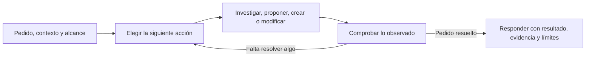
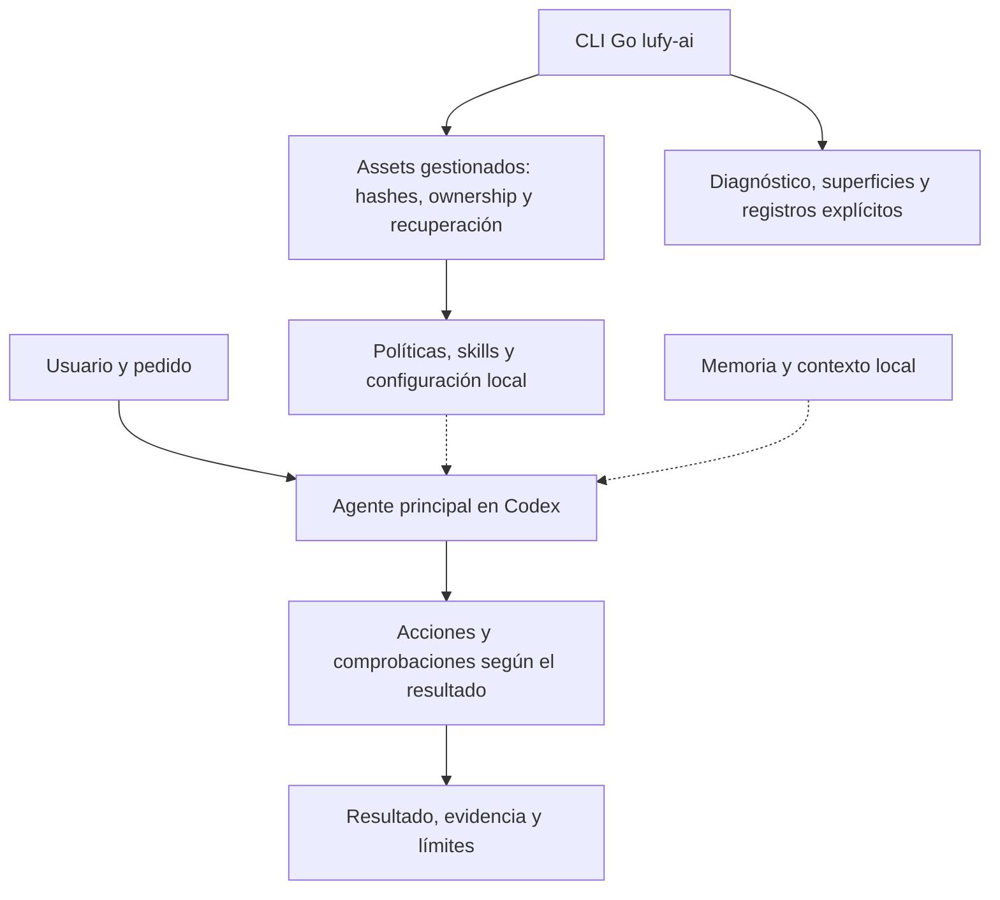

# lufy-ai

<p align="center">
  
</p>

<p align="center">
  Desarrollo con IA centrado en resultados: contexto, autonomía y comprobaciones para llevar una idea hasta un resultado verificable.
</p>

<p align="center">
  <a href="#qué-es-lufy">Qué es</a> •
  <a href="docs/manual/README.md">Manual visual</a> •
  <a href="#quickstart">Quickstart</a> •
  <a href="#flujo-de-trabajo">Flujo</a> •
  <a href="#autonomía-y-paralelismo">Autonomía</a> •
  <a href="#arquitectura">Arquitectura</a> •
  <a href="#cli-y-operación-local">CLI</a> •
  <a href="#estado-actual">Estado</a> •
  <a href="#documentación">Documentación</a>
</p>

---

## Qué es Lufy

Lufy es un harness instalable para trabajar con IA en Codex: reúne políticas de trabajo, configuración del proyecto, skills y una CLI Go para mantener esa integración. El agente principal conserva el contexto, elige las acciones útiles y lleva el pedido hasta un resultado comprobable.

Ese resultado puede ser una app desde cero, una nueva funcionalidad, una corrección, una investigación, un análisis de datos, una propuesta o un texto. La forma de trabajar y la evidencia se adaptan a lo que pedís y a las consecuencias de equivocarse.

El flujo actual usa ejecución inline. Puede incorporar TDD, exploración, diseño, revisión, memoria y colaboración cuando ayuden al trabajo. Una propuesta puede terminar sin implementación y una explicación puede terminar sin escribir archivos.

**Disponibilidad:** el flujo inline ya está integrado en `develop` y todavía no tiene release publicada. La última referencia estable, `v0.6.25`, pertenece al modelo anterior. Los formatos son incompatibles; para usar el modelo actual, compilá desde `develop` siguiendo el quickstart.

## Qué problema busca resolver

Trabajar con IA implica sostener el contexto, decidir qué hacer a continuación y reconocer si el resultado resuelve el pedido. También implica distinguir una acción autorizada de una ampliación de alcance y una comprobación real de una afirmación del agente.

Lufy organiza ese trabajo alrededor de cuatro necesidades:

| Necesidad | Cómo la aborda |
| --- | --- |
| Mantener dirección durante el trabajo | El principal conserva el resultado buscado, el alcance, las decisiones y la condición de término. |
| Elegir acciones según la tarea | Investigar, proponer, escribir, implementar o verificar se combinan según el contexto y lo observado. |
| Comprobar lo que se entrega | La evidencia corresponde al resultado: comportamiento, fuentes, fidelidad editorial, consultas o estado posterior. |
| Mantener la integración del proyecto | Configuración local, assets con ownership y hashes, sincronización, conflictos, backups y recuperación. |

Las capacidades son herramientas para esas necesidades. No hay selección obligatoria de metodología por tier, cadenas de roles, scores de aprobación ni documentos prefijados para cada pedido. Los ensayos y sus límites se publican como evidencia, sin atribuirles una ventaja universal del proceso.

## Quickstart

### 1. Compilar el código actual

Requiere Go según [go.mod](tools/lufy-cli-go/go.mod), actualmente 1.24.2. Desde un checkout actualizado de `develop`, en un shell POSIX:

```sh
mkdir -p "$HOME/.local/bin"
go -C tools/lufy-cli-go build -o "$HOME/.local/bin/lufy-ai" ./cmd/lufy-ai
export PATH="$HOME/.local/bin:$PATH"
lufy-ai version --runtime-contract
```

Usá un destino libre o respaldá el ejecutable existente antes de reemplazarlo. El hook de Codex necesita `lufy-ai` en el PATH del entorno que inicia el host. Para Windows, PATH y recuperación entre generaciones, consultá [instalación](docs/installation.md).

### 2. Revisar, instalar y verificar

```sh
lufy-ai install --target /ruta/al/proyecto --tool codex --delegation off --dry-run
lufy-ai install --target /ruta/al/proyecto --tool codex --delegation off --yes
lufy-ai verify --target /ruta/al/proyecto --deep
```

El ejemplo elige `off` para trabajar completamente en el principal. El default del producto es `auto`; también podés elegir `on_request`. El preview permite revisar las acciones antes de aplicar. La instalación soportada es Codex project-local.

Estos comandos corresponden a un proyecto nuevo o de la generación actual. Los estados anteriores se rechazan y no se convierten automáticamente. Una recuperación entre generaciones requiere el ejecutable y el snapshot conjunto correspondientes.

### 3. Abrir el proyecto y pedir un resultado

Abrí el proyecto de destino en Codex. Por ejemplo:

> Analizá por qué el listado repite resultados al cambiar de página, corregí la causa y comprobá que los filtros sigan funcionando.

El principal usa las instrucciones, la configuración y las skills pertinentes. Inspecciona las dependencias, reproduce el problema cuando sea posible, corrige dentro del alcance y comprueba el comportamiento. Te consulta si falta una decisión material y puede continuar con lo que no dependa de ella.

Al terminar, informa qué cambió, qué observó y qué quedó pendiente. Si también autorizaste commit, push y PR, continúa con esa entrega y observa los checks remotos. Una petición de análisis por sí sola termina con el diagnóstico.

### 4. Inicializar capacidades adicionales cuando hagan falta

```sh
lufy-ai memory init --target /ruta/al/proyecto
lufy-ai context build --target /ruta/al/proyecto --json
lufy-ai skills ensure --target /ruta/al/proyecto
```

La memoria conserva conocimiento durable; el grafo ayuda a localizar relaciones lexicales entre fuentes; el registry resuelve las skills instaladas. Podés consultar [memoria y contexto](docs/memory-context.md) antes de activar o modificar datos existentes.

## Flujo de trabajo

El [manual visual e interactivo](docs/manual/README.md) permite explorar ocho pedidos con conversaciones, pasos, diagramas y resultados finales de ejemplo. Se abre como HTML desde el checkout.

El principal decide el siguiente paso a partir del pedido, las dependencias y la evidencia disponible. El ciclo admite volver atrás, acotar una hipótesis o cambiar de estrategia:



El diagrama orienta el trabajo; no establece fases obligatorias ni exige implementar todos los pedidos. Una corrección pequeña puede resolverse directamente. Un trabajo incierto puede necesitar fuentes adicionales, una reproducción, una propuesta o una prueba exploratoria.

### La tarea determina la evidencia

| Pedido | Qué hace falta comprobar |
| --- | --- |
| Explicación o investigación | Fuentes pertinentes, afirmaciones contrastadas, diferencias entre hechos e inferencias y límites. |
| Propuesta o diseño | Necesidad, alternativas, tradeoffs, factibilidad y decisiones abiertas. |
| App desde cero | Una primera porción funcional, integración real y restricciones del producto; después ampliar preservando lo comprobado. |
| Funcionalidad, corrección o refactor | Comportamiento solicitado, contratos afectados y regresiones relevantes. |
| Redacción o traducción | Fidelidad, exactitud, coherencia, tono y formato. |
| Análisis de datos | Procedencia, granularidad, nulos, duplicados, unidades y consultas reproducibles. |
| Operación o recuperación | Efecto autorizado y estado posterior observado. |

Las pruebas se eligen por lo que permiten distinguir. El mismo ejecutor puede usar TDD e implementar; una revisión independiente puede aportar otra perspectiva. Las suites completas se agrupan en un momento útil y se repite la comprobación afectada cuando cambia su fuente o candidato.

### Dos pedidos sobre el mismo problema

«Analizá por qué se duplican las ventas» puede resolverse identificando el join que multiplica filas, mostrando una consulta reproducible y explicando su impacto. No requiere modificar datos para que el diagnóstico esté completo.

«Analizá y corregí la duplicación en el reporte» agrega una corrección dentro del alcance: revisar la granularidad, ajustar la consulta y comparar resultados con casos conocidos. Si la solución requiere una migración o una acción externa no autorizada, esa decisión se consulta antes de ejecutarla.

Más criterios y ejemplos: [flujo de trabajo](docs/harness-workflow.md) y [política de evidencia](.lufy/contracts/evidence.md).

## Autonomía y paralelismo

El agente resuelve detalles técnicos convencionales dentro del pedido y comunica avances materiales. Consulta cuando falta una decisión de producto, alcance o acceso que no pueda resolver con las fuentes disponibles. Las actualizaciones de progreso permiten seguir el trabajo sin aprobar cada paso interno.

La ejecución es `inline`: el principal conserva la responsabilidad aunque colabore con otros agentes. La política del proyecto define cuándo puede delegar:

```yaml
schema_version: 2
tool: codex
execution:
  mode: inline
  delegation: auto
```

| Delegación | Comportamiento |
| --- | --- |
| `off` | Todo se resuelve en el principal. |
| `on_request` | Delega ante un pedido explícito del usuario. |
| `auto` | Puede delegar cuando aporte valor; es el default del producto. |

Para paralelizar, cada tarea necesita un objetivo acotado, contexto mínimo, ownership de archivos y aceptación observable. Se resuelven primero las decisiones compartidas; después pueden avanzar investigaciones independientes o cambios en módulos separados. El principal integra los resultados y comprueba el conjunto.

Las escrituras sobre los mismos archivos, decisiones de seguridad o contratos todavía abiertos y operaciones sobre estado compartido necesitan coordinación. `parallel_execution` orienta esa colaboración; no lanza agentes por sí solo. Las herramientas disponibles, los permisos del host y una instrucción del usuario de trabajar inline prevalecen.

Commit, push, PR, publicación y cambios externos requieren autorización explícita. Una autorización vigente se conserva dentro de su alcance; ni delegar ni registrar un plan la amplían. Ver [configuración](docs/configuration.md) y [política de entrega](.lufy/contracts/delivery.md).

## Qué instala y qué conserva

El catálogo Codex contiene **16 assets y cinco skills**, además del generador del bloque de `AGENTS.md`.

| Superficie | Contenido |
| --- | --- |
| `AGENTS.md` | Bloque Lufy gestionado; se conserva el contenido propio fuera del bloque. |
| `.codex/` | Configuración, hook de orientación, reglas, guía y descripción de ejecución. |
| `.agents/skills/` | `lufy-check` y cuatro skills de memoria: capture, connect, document y search. |
| `.lufy/contracts/` | Políticas de trabajo, evidencia y entrega, con su índice. |
| `.lufy/README.md` | Orientación sobre configuración, estado y datos locales. |
| `lufy-ia.harness.md` | Guía compartida del trabajo inline. |

La instalación mantiene ownership y hashes de los archivos seleccionados. Un archivo propio no se vuelve gestionado por estar dentro de una de esas carpetas. Las actualizaciones reconocen drift y conflictos antes de sobrescribir; la memoria personal conserva su propiedad.

### Datos del proyecto

| Ruta | Función |
| --- | --- |
| `.lufy/config/project.yaml` | Configuración schema 2: ejecución, superficies, stacks, validaciones y capacidades. |
| `.lufy/managed-state/install-state.json` | Manifest schema 4: assets, ownership y hashes. |
| `.lufy/managed-state/backups/` | Backups schema 2 ligados a estado 4; recuperación de la generación actual. |
| `.lufy/memory/` | Conocimiento portable Obsidian, inicializado y mantenido aparte de los assets. |
| `.lufy/context/` | Grafo lexical y derivados reconstruibles. |
| `.lufy/skill-registry.json` | Registro derivado de skills disponibles. |
| `.lufy/runtime/` | Eventos y proyecciones locales cuando se usan productores explícitos del ledger. |

El único hook instalado orienta `SessionStart`: puede refrescar el registry de skills y consultar estado de memoria/contexto. No registra conversaciones, reviews o runs automáticamente. La política de Git de cada tipo de dato debe revisarse en el proyecto de destino.

## Arquitectura

El agente lleva el trabajo; la CLI instala y mantiene las piezas que lo orientan y permiten inspeccionar el proyecto.



| Componente | Responsabilidad |
| --- | --- |
| Configuración y dominio | Ejecución inline, delegación, perfil del proyecto y validación de formatos actuales. |
| Adapter Codex y catálogo | Renderizar la superficie project-local y el bloque gestionado de la guía. |
| Assets y estado | Fuente/mirror, hashes, ancestors, conflictos y manifest. |
| Instalación y recuperación | Install, sync, uninstall, backup, restore y comprobación de generación en upgrade. |
| Memoria, skills y contexto | Conocimiento portable, descubrimiento de capacidades e índice lexical. |
| Evidencia y observabilidad | Comprobaciones declaradas, vinculación al candidato y eventos locales explícitos. |

Las fuentes editoriales seleccionadas viven en la raíz; `tools/lufy-cli-go/internal/assets/embedded` es su mirror de distribución. La validación exige paridad. El [detalle de arquitectura](docs/architecture.md) y los [ADRs](docs/adr/README.md) documentan decisiones e invariantes.

## CLI y operación local

| Comandos | Uso |
| --- | --- |
| `init`, `scan`, `plan` | Detectar configuración y superficies; resolver un plan read-only de contratos y validaciones. |
| `install`, `sync`, `uninstall` | Mantener la integración gestionada con preview, ownership y recuperación. |
| `status`, `info`, `doctor`, `verify` | Inspeccionar instalación, drift, configuración y hashes. |
| `conflicts plan`, `merge`, `pin`, `unpin` | Diagnosticar conflictos, resolver candidatos o congelar assets. |
| `backup`, `restore` | Crear y recuperar snapshots de archivos gestionados de la generación actual. |
| `memory`, `skills`, `context` | Mantener y consultar conocimiento y derivados locales. |
| `evidence`, `candidate`, `review`, `run` | Inspección y registros opcionales; no ejecutan una review ni conceden permisos de entrega. |
| `adaptive` | Asignación experimental opt-in; no crea agentes. |
| `setup`, `menu`, `version`, `upgrade` | Preparación, interfaz TTY e identidad/gestión del ejecutable. |
| `pr guard`, `lifecycle codex` | Guardas de paths del diff y orientación de sesión. |

### Inspeccionar el proyecto antes de cambiarlo

```sh
lufy-ai status --target /ruta/al/proyecto
lufy-ai info --target /ruta/al/proyecto --json
lufy-ai doctor --target /ruta/al/proyecto --json
lufy-ai plan --target /ruta/al/proyecto --base origin/develop --json
```

`plan` necesita superficies configuradas y una base Git válida cuando deriva archivos del diff. También admite selección explícita con `--files`. Propone alcance y validaciones declaradas; no ejecuta esas validaciones ni autoriza cambios.

### Setup y command palette

`setup` puede orquestar instalación, configuración, memoria, grafo y verify. Para trabajar con el código inline mientras la release estable corresponde al modelo anterior:

```sh
lufy-ai setup --target /ruta/al/proyecto --skip-version-check --dry-run
lufy-ai setup --target /ruta/al/proyecto --skip-version-check --yes
```

Revisá el preview y la configuración existente antes de aplicar. `lufy-ai menu` abre el command palette en una terminal interactiva. El help del ejecutable y de sus subcomandos describe los flags disponibles; la [referencia de CLI](docs/cli.md) explica sus efectos y precondiciones.

### Sincronización, conflictos y recuperación

```sh
lufy-ai sync --target /ruta/al/proyecto --dry-run
lufy-ai conflicts plan --target /ruta/al/proyecto --json
lufy-ai sync --target /ruta/al/proyecto --yes
lufy-ai verify --target /ruta/al/proyecto --deep
```

Un conflicto puede producir un candidato `.lufy-new`. Se inspecciona antes de resolverlo con `merge`; `pin` permite conservar deliberadamente un asset local. `sync` no instala automáticamente assets nuevos ausentes que nunca estuvieron registrados.

```sh
lufy-ai backup --target /ruta/al/proyecto
lufy-ai restore --target /ruta/al/proyecto --list
lufy-ai uninstall --target /ruta/al/proyecto --dry-run
```

El backup mínimo no sustituye una copia completa del proyecto o del ejecutable. Restore valida generación, paths, hashes y payload antes de escribir. La [guía de instalación y recuperación](docs/installation.md) desarrolla estos casos.

## Desarrollar y validar Lufy

Los cambios al propio Lufy siguen el mismo enfoque: entender el problema, elegir una unidad revisable, implementar lo necesario y comprobar sus efectos. Una propuesta o un plan breve ayudan cuando hay incertidumbre o alcance amplio; los arreglos pequeños pueden resolverse directamente.

La CLI Go vive en `tools/lufy-cli-go`. `scripts/install.sh` es un wrapper estricto de esa CLI. Si cambia un asset distribuido, su fuente y mirror embebido deben quedar en paridad. El conocimiento histórico se conserva con sus fechas y límites, sin presentarlo como instrucciones actuales.

Desde la raíz:

```sh
scripts/validate.sh
```

La validación agrupada comprueba whitespace y paths del diff, workflows, versiones, paridad de assets, regresiones Python offline y la CLI Go con coverage, vet y build. El umbral Go es 80%. ShellCheck se aplica cuando está disponible localmente y es obligatorio en el gate Ubuntu de CI. Los ensayos con modelos son opt-in y se ejecutan por separado con autorización.

Para PRs contra `develop`, el whitespace debe cubrir el rango real:

```sh
git diff --check origin/develop...HEAD
# Si hay cambios pendientes:
git diff --check origin/develop
```

Los [gates](docs/ci-quality-gates.md), [contribuciones](CONTRIBUTING.md) y el [README de la CLI](tools/lufy-cli-go/README.md) describen el desarrollo local y sus comprobaciones.

## Integración y releases

- `develop` es la base normal de trabajo e integración; `main` contiene la línea estable.
- Commit, push, PR, merge y publicación se realizan dentro de la autorización recibida y con evidencia de sus resultados.
- Un PR se integra después de observar sus checks remotos pertinentes.
- Las releases estables usan tags `v*` sobre commits alcanzables desde `main`.
- La promoción a `main` puede disparar tagging y publicación automática según los labels del PR; la versión preparada debe coincidir con ese cálculo.

Integrar código a `develop` y publicar una nueva versión son acciones distintas. La [guía de releases](docs/releasing.md) cubre versión, changelog, distribución y E2E del artifact publicado. La [seguridad de releases](docs/release-security.md) distingue checksum, contrato de formato y firma.

## Estado actual

| Área | Situación |
| --- | --- |
| Flujo inline | Integrado en `develop`; el principal adapta acciones y evidencia al pedido. |
| Codex | Único adapter escribible, project-local, con delegación configurable. |
| Instalación | 16 assets, cinco skills, configuración 2, manifest 4 y backups 2 para estado 4. |
| Memoria y contexto | Obsidian portable e índice lexical v3; su uso depende de la necesidad. |
| Evidencia y ledger | Integraciones explícitas opcionales; sus registros no demuestran por sí solos calidad o autoría. |
| Asignación adaptativa | Experimental y deshabilitada por default. |
| Publicación | La generación inline todavía no tiene release publicada. |

Se retiraron motores SDD/OpenSpec, selección de metodología por tiers, Result Contract y adapters anteriores. Sus informes permanecen como historia y no se distribuyen como motores activos.

La evaluación con fixtures de seis familias y una comparación de 24 turnos no acredita una ventaja general ni menor costo humano. Memoria, grafo y delegación requieren evidencia contextual para atribuirles una mejora. El [estado detallado](docs/status.md), la [historia](docs/history/README.md) y las [hipótesis de evolución](docs/roadmap.md) mantienen esas distinciones.

## Documentación

| Guía | Contenido |
| --- | --- |
| [Manual visual](docs/manual/README.md) | Recorridos interactivos por tipo de pedido, participantes y resultados. |
| [Índice](docs/README.md) | Navegación y fuentes canónicas de documentación. |
| [Flujo](docs/harness-workflow.md) | Trabajo inline, tipos de pedido, autonomía y ejemplos. |
| [Instalación](docs/installation.md) | Compilación, PATH, sync, conflictos y recuperación. |
| [Configuración](docs/configuration.md) | Defaults, delegación, superficies y capacidades. |
| [CLI](docs/cli.md) | Operaciones, flags y precondiciones. |
| [Memoria y contexto](docs/memory-context.md) | Notas durables, backlinks, skills y grafo lexical. |
| [Evidencia](docs/evidence.md) | Comprobaciones declaradas, candidato Git y review explícita. |
| [Run Ledger](docs/run-ledger.md) | Eventos causales locales, privacidad, retención y recuperación. |
| [Arquitectura](docs/architecture.md) | Componentes, fuentes, derivados y decisiones. |
| [Diagnóstico](docs/troubleshooting.md) | Drift, formatos, runtime y recuperación. |
| [Estado](docs/status.md) y [evolución](docs/roadmap.md) | Capacidades actuales, evidencia y problemas por evaluar. |
| [Releases](docs/releasing.md) | Preparación y verificación de publicación. |

## Licencia

[MIT](LICENSE).
