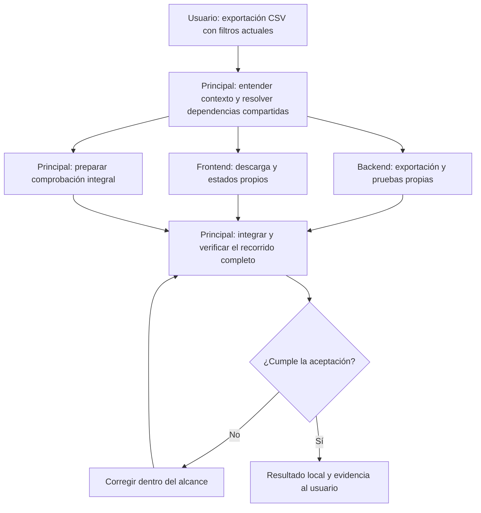

# Propuesta: Lufy centrado en resultados, con ejecución inline

Fecha de propuesta: 24 de octubre de 2026. Implementación del 27/10: [bloque 1, política y piloto](implementacion/bloque-1.md), [bloque 2, configuración y catálogo inline](implementacion/bloque-2.md), [bloque 3, evidencia y capacidades](implementacion/bloque-3.md) y [bloque 4, instalación personal](implementacion/bloque-4.md), implementados y validados. La instalación personal ya usa el flujo inline; el código permanece en el checkout aislado, pendiente de integración.

[Bloque 5, comparación exploratoria y seguimientos](implementacion/bloque-5-comparacion.md): 24 turnos nuevos completados. El estudio terminó con una conclusión comparativa inconclusa para ventaja general/costo humano; la dirección inline autorizada se informa por separado. El [piloto previo](implementacion/bloque-5.md) y sus límites quedan como historia.

[Bloque 6, retiro de motores y recuperación](implementacion/bloque-6.md): fuente depurada e instalación personal actualizada a manifest 4 / backups 2. Validación agrupada aprobada, cobertura Go 80,6%, recuperación e interrupciones ensayadas. El código completo y patch acumulado siguen pendientes de integración Git; no hay release nuevo.

[Entrega de la rama](entrega.md): commit y push autorizados el 28/10/2026 sobre `codex/lufy-inline`; integración a `develop` y publicación fuera de este pedido. Los informes anteriores conservan el estado observado en su fecha.

[Mejora posterior del evaluador, 29/10](implementacion/mejora-evaluador-2026-10-29.md): gramática de comandos ampliada, diagnósticos por evento y procedencia; 13 comandos antes desconocidos ahora reconocidos como lecturas. Validada localmente; entrega autorizada mediante la rama `codex/improve-inline-evaluator` y PR hacia `develop`.

Revisión de alcance: Lufy tiene un único usuario, su autor. Por instrucción explícita suya, no hay requisito de retrocompatibilidad. La propuesta permite cambios incompatibles de configuración, comandos, formatos y estructura; no conserva motores ni consumidores históricos para atender instalaciones ajenas.

Base técnica: `origin/develop`, commit `1cc18d4647afc61ea1f6b1cb726ba74128fded5f`, versión `v0.6.25`. El análisis usa ese snapshot porque el checkout local está atrasado y contiene trabajo ajeno a esta propuesta. Elaboración inline, sin delegación, sin crear un change de OpenSpec y sin ejecutar el workflow que se propone retirar.

## 1. Decisión recomendada

Reestructurar Lufy para que ayude al agente a terminar el trabajo pedido, eligiendo acciones y comprobaciones según el resultado buscado. La ejecución inline será el comportamiento predeterminado. El proceso podrá cambiar durante el trabajo cuando aparezca nueva evidencia, dentro de la autorización existente.

Retirar del camino principal la selección obligatoria `T1/T2/T3 → metodología → roles → artefactos → gates`. No agregar una cuarta metodología a `openspec`, `lufy-sdd` y `none`. Tampoco convertir ODD en una dependencia o cambiar las etiquetas de SDD conservando las mismas obligaciones.

Conservar la infraestructura que resuelve problemas concretos: instalación segura, propiedad de archivos, reversión, configuración del proyecto, conocimiento de superficies, permisos efectivos y comprobaciones de resultados. Cada componente restante deberá justificar su costo y tener una condición de retiro si deja de aportar valor.

La propuesta contiene cuatro documentos:

- Este documento: dirección de producto, comportamiento y arquitectura.
- [Inventario de conservación, modificación y retiro](inventario.md): destino de componentes y rutas actuales.
- [Transición y evaluación](evaluacion.md): bloques de implementación, aceptación y experimentos.
- [Fuentes y límites de la investigación](fuentes.md): evidencia local y externa que fundamenta las decisiones.

## 2. Problema que queremos resolver

Lufy ya incluye ejecución proporcional, análisis sin cambios, evidencia vinculada a candidatos, instalación idempotente y experiencia acumulada en Codex. La propuesta aprovecha esos resultados. No parte de afirmar que toda la versión actual falla.

El problema estructural es que la metodología sigue ocupando el centro del modelo. `HarnessConfig` contiene `MethodologyByTier`; sus defaults asignan OpenSpec a T1 y T2; la política rechaza T1 sin metodología y restringe T2 sin ella. Catálogo, instalación, configuración, flags y estado persistido consumen esa decisión. Cambiar solamente el prompt del router dejaría vigente ese acoplamiento en el producto. Véase [evidencia técnica](fuentes.md#evidencia-local).

Además, algunas reglas equiparan calidad con una forma específica de producirla: delegar TDD, obtener una puntuación de review o completar una cantidad mínima de escenarios. Esas prácticas pueden ayudar en un contexto, pero no demuestran por sí mismas que una investigación sea correcta, que una traducción conserve el sentido o que un refactor preserve comportamiento.

La consecuencia que debemos medir es el trabajo extra que no mejora el resultado: transferencias de contexto, documentos redundantes, aprobaciones repetidas, validaciones irrelevantes y bloqueos originados en el proceso. También debemos medir el riesgo inverso: al simplificar, perder restricciones, reproducibilidad o capacidad de recuperación.

Los experimentos locales anteriores no establecieron superioridad del baseline ni de su alternativa: el ensayo inline/referencia quedó incompleto. Esa incertidumbre exige comparar de nuevo; no obliga a conservar el diseño actual indefinidamente. [Evidencia y límites](fuentes.md#evidencia-local).

## 3. Unidad de trabajo: resultado, alcance y evidencia

Lufy necesita reconocer seis aspectos. Son preguntas de trabajo; no un formulario que el usuario deba completar en cada pedido.

| Aspecto | Pregunta | Consecuencia práctica |
| --- | --- | --- |
| Resultado | ¿Qué necesita obtener la persona? | Explicación, alternativas, documento, comportamiento nuevo, diagnóstico o estado operativo. |
| Objeto y contexto | ¿Sobre qué trabajamos y qué restricciones existen? | Código, datos, texto, arquitectura, interfaz, servicio; fuentes y entorno relevantes. |
| Acciones autorizadas | ¿Qué efectos cubre el pedido? | Leer, escribir localmente, ejecutar, modificar datos, publicar o entregar tienen alcances distintos. |
| Incertidumbre y consecuencias | ¿Qué desconocemos y qué podría salir mal? | Determina dónde investigar, experimentar, revisar o requerir una decisión humana. |
| Evidencia | ¿Qué permitiría aceptar o rechazar el resultado? | Pruebas de comportamiento, consultas reproducibles, fuentes contrastadas, fidelidad editorial o estado observado. |
| Finalización | ¿Qué significa haber terminado este pedido? | Una propuesta puede terminar sin implementación; una operación requiere verificar el efecto solicitado. |

La intención puede ser comprender, investigar, proponer, crear, transformar, verificar u operar. Estas palabras ayudan a elegir acciones; no se convierten en un enum cerrado, nuevos agentes o rutas rígidas.

El riesgo se explica mediante consecuencias concretas: datos que podrían perderse, contrato que podría romperse, información que falta, irreversibilidad o alcance operativo. Se retira el tier obligatorio del nuevo modelo, junto con sus traducciones y bridges. Las integraciones propias afectadas se actualizan o eliminan en el mismo cambio.

Ejemplo: «analizá por qué se duplican las ventas» pide un diagnóstico sobre datos. La evidencia adecuada puede ser identificar la granularidad de dos tablas y mostrar un join mínimo que multiplica filas. El resultado no necesita una implementación, cobertura Go ni una migración. Tampoco autoriza borrar registros.

## 4. Cómo trabajaría el agente

El agente principal conserva el contexto, decide la siguiente acción útil y comprueba lo que esa acción aporta. Puede leer, buscar, preguntar, comparar, diseñar, reproducir, escribir, ejecutar o revisar. La observación obtenida determina si continúa, cambia de estrategia, solicita una decisión que falta o termina.

```text
Pedido y contexto
      ↓
Resultado buscado + alcance autorizado + condiciones de aceptación
      ↓
Acción útil → observación → ajuste de la estrategia
      ↑                         │
      └─────────────────────────┘
      ↓
Resultado con evidencia y límites

Las restricciones del proyecto y del host se aplican en cada acción.
```

Este esquema describe un bucle de trabajo. No exige ejecutar todas sus acciones ni producir un archivo por etapa. Una traducción breve puede resolverse con lectura, edición y comparación. Una funcionalidad puede requerir explorar el dominio, construir un ejemplo, implementar y probar. Una pregunta factual puede resolverse con una búsqueda y una respuesta fundamentada.

### Ejecución inline y capacidades especializadas

El comportamiento predeterminado es que el agente principal lleve una unidad coherente hasta su resultado, incluyendo las pruebas apropiadas. No necesita representar sucesivamente a `router`, `explorer`, `implementer` y `validator`, ni enviarse handoffs a sí mismo.

Las capacidades especializadas se cargan cuando ayudan: diseño de experimentos, revisión de seguridad, TDD, análisis SQL, redacción, revisión de código o entrega. Una capacidad puede ser una instrucción breve, una herramienta o una delegación real. No requiere un nuevo agente permanente.

La recomendación para el producto futuro es permitir delegación automática dentro del alcance autorizado, cuando la política del proyecto y las capacidades del host lo permitan. El usuario no tiene que repartir tareas ni aprobar cada subagente. Cada delegación necesita una razón concreta: fuentes independientes, otra perspectiva u oráculo de validación, aislamiento o trabajo realmente independiente. Se conservan propiedad de archivos, contexto mínimo y responsabilidad del principal por el resultado integrado. El agente puede elegir trabajar solo si delegar agrega costo o coordinación sin beneficio.

La política propuesta permite `auto`, `on_request` y `off`: en `auto` el agente elige dentro de los límites existentes; en `on_request` delega cuando el usuario lo pide; en `off` resuelve en el agente principal. Es una elección de organización, separada de los permisos para modificar, publicar u operar. Una instrucción del usuario de trabajar inline prevalece. Esta propuesta no cambia la configuración ni las restricciones del host actual; la elaboración de estos documentos sigue inline.

Los agentes registrados como read-only continúan siendo read-only. Inline se refiere al agente principal del host con sus permisos efectivos; no habilita escrituras en un `orchestrator` restringido ni simula una delegación inexistente.

### Planificación y registros proporcionales

No se crea un plan persistido para cada pedido. Se registra un acuerdo breve cuando hay decisiones que sobrevivirán a la conversación, varios bloques dependientes, una transición de contexto o una revisión que lo necesita.

Ese acuerdo puede vivir en el issue, documento, prueba, contrato o archivo que ya representa el trabajo. Debe expresar el resultado, las restricciones, las decisiones abiertas y cómo se comprobará. No se duplica en `proposal + design + tasks + specs + result` por obligación.

Un proyecto grande necesita acuerdos de dominio, límites arquitectónicos y una secuencia de entregas verificables. Se escribe cada uno por el problema que resuelve. Tener pocas carpetas no vuelve sencilla una arquitectura compleja; tener muchos artefactos no la vuelve correcta.

La comparación de alternativas ocurre antes de una decisión costosa cuando aporta información. No se generan dos propuestas por defecto. Si las alternativas cambian producto, contrato público o seguridad y no hay una preferencia autorizada, el agente presenta el trade-off al usuario.

### Autonomía dentro del alcance

«Analizá y corregí este bug» autoriza diagnóstico y una corrección acotada. El agente continúa entre esas acciones cuando cuenta con información suficiente y cumple los controles independientes del entorno. No repite la misma solicitud de autorización después de redactar su propio plan.

«Analizá este bug» autoriza análisis. Descubrir la solución no agrega permiso para aplicarla. Lo mismo vale para una propuesta de esquema, un borrador y una publicación, o un análisis SQL y un cambio de datos.

Los bloqueos legítimos son específicos: falta acceso, existe una restricción efectiva del host, hay una decisión relevante no resuelta, una fuente no permite concluir o una acción excede la autorización. Se elimina el bloqueo basado únicamente en que falta un artefacto metodológico.

### Interacción que debería esperar el usuario

El objetivo para un pedido claro es una instrucción inicial y un resultado comprobado, con actualizaciones informativas durante el trabajo. No hay cantidad prometida de mensajes: un proyecto ambiguo puede necesitar decisiones antes de construir. El agente consulta sólo lo que cambia materialmente el resultado y no puede resolver con el contexto disponible.

| Situación | Qué hace el agente | Interacción del usuario |
| --- | --- | --- |
| Objetivo y alcance claros | Investiga, decide implementación, escribe y comprueba hasta terminar. | Pedido inicial; actualizaciones sin obligación de responder. |
| Detalle técnico convencional y reversible | Usa las convenciones del proyecto y explicita una suposición relevante. | No pide elegir cada nombre, archivo, patrón o test. |
| Decisión de negocio con resultados sustancialmente distintos | Presenta el punto concreto, opciones y recomendación. | Resuelve esa decisión; no aprueba un documento entero por protocolo. |
| Trabajo independiente disponible mientras falta una respuesta | Continúa esa parte; reserva el trabajo dependiente. | La pregunta sigue pendiente; el silencio no es aprobación. |
| Falla una comprobación dentro del alcance | Diagnostica, corrige y vuelve a comprobar lo afectado. | No pide permiso para cada intento; informa si queda un bloqueo real. |
| Surge un efecto no autorizado o una restricción efectiva del host | Se detiene antes de ese efecto y explica qué falta. | Decide sólo si quiere ampliar el alcance o conceder el acceso requerido. |
| Publicación u operación ya solicitada y suficientemente autorizada | Ejecuta con precondiciones y controles efectivos satisfechos. | No repite una autorización que ya existe. |

El agente principal es el único interlocutor ordinario. Los subagentes no distribuyen preguntas al usuario: devuelven el problema al principal, que intenta resolverlo y agrupa las decisiones humanas necesarias. El principal revisa el resultado integrado; el usuario no hace de coordinador ni de integrador.

### Cómo se decide el paralelismo

La secuencia depende de las dependencias del trabajo, no de una lista fija de roles. Primero se comprende el contexto y se resuelve lo compartido que condiciona las ramas. Después pueden solaparse tareas que ya tienen entradas suficientes, objetivos verificables y responsabilidad delimitada.

Para delegar en paralelo deben cumplirse estas condiciones:

- La política y el host permiten delegación; el pedido del usuario no la prohíbe.
- Cada rama puede avanzar sin inventar una decisión compartida pendiente.
- Se delimitan archivos o productos propios; se evita que dos escritores editen los mismos archivos al mismo tiempo. Worktrees aislados no eliminan conflictos conceptuales.
- Las herramientas y permisos de cada rama se mantienen dentro de lo autorizado; dividir la tarea no amplía autoridad.
- El principal define cómo reunirá y comprobará los resultados. Una revisión de un estado intermedio no acredita automáticamente la integración final.
- El beneficio esperado justifica contexto, tiempo y coordinación. La disponibilidad de slots no obliga a llenarlos.

El reparto puede cambiar durante el trabajo. Una rama bloqueada no detiene las independientes; una dependencia nueva puede obligar a reunir resultados y continuar secuencialmente. Los contratos compartidos no se diseñan por separado para reconciliarlos al final. Git, integración de cambios y operaciones sobre estado compartido se coordinan por un solo responsable.

### Ejemplo: exportar movimientos a CSV

Pedido: «Agregá exportación CSV de movimientos con los filtros actuales. Dejalo funcionando localmente».

1. El principal revisa modelo, filtros, permisos, interfaz y comprobaciones existentes. Define internamente campos y comunicación entre backend y frontend a partir de esas convenciones. Sólo consulta si encuentra una decisión de producto o acceso que no puede inferir.
2. Si la política permite paralelismo y el cambio tiene partes independientes, una rama implementa exportación y sus pruebas en backend; otra implementa botón, descarga y estados de error en frontend. Cada una tiene archivos propios y el mismo acuerdo de datos. Mientras avanzan, el principal prepara la comprobación de integración y los casos de permisos/filtros.
3. El principal reúne cambios, comprueba que ambas partes se entiendan y ejecuta el recorrido completo. Corrige fallos y vuelve a comprobar lo afectado dentro del mismo alcance.
4. Entrega el resultado local, evidencia y límites. Publicar no estaba incluido. Si el pedido ya hubiera autorizado entrega o publicación, continuaría con sus controles correspondientes sin otra aprobación metodológica.



Si se descubre que hace falta definir qué grupos pueden descargar datos que hoy sólo visualizan, el principal consulta esa decisión de acceso antes de implementar esa política. Puede continuar las partes que no dependan de la respuesta. No pregunta si debe crear un subagente o ejecutar un test pertinente.

En una investigación, el paralelismo puede separar fuentes o hipótesis antes de sintetizar; en una redacción, hechos y revisión editorial; en datos, hipótesis independientes con consultas autorizadas y carga controlada. Un bug pequeño suele resolverse mejor inline. Crear una aplicación desde cero necesita primero un mínimo acuerdo de dominio antes de repartir módulos dependientes.

## 5. Evidencia según el trabajo

| Trabajo | Estrategia inicial posible | Evidencia de finalización | Motivo legítimo para profundizar |
| --- | --- | --- | --- |
| Explicar un sistema | Leer puntos de entrada y dependencias relevantes | Explicación trazable a la versión revisada; límites explícitos | Fuentes contradictorias o comportamiento no observable. |
| Investigar | Formular la pregunta, buscar, contrastar y sintetizar | Fuentes pertinentes, procedencia, desacuerdos y grado de conclusión | Evidencia insuficiente o afirmación decisiva sin respaldo. |
| Pensar una propuesta | Explorar necesidades y alternativas antes de converger | Opciones viables, elección razonada, consecuencias y decisiones abiertas | Cambio de dirección de producto no autorizado. |
| Crear desde cero | Acordar el mínimo útil y construir un recorrido completo | Comportamiento observable de extremo a extremo y límites del producto | Integraciones, datos reales o publicación fuera del alcance. |
| Agregar una función | Entender contratos, implementar un incremento y comprobar integración | Nuevo comportamiento y preservación de lo afectado | Cambio transversal de contrato o seguridad. |
| Corregir un bug | Reproducir, explicar la causa, corregir y comprobar regresión | Caso que falla antes y pasa después cuando sea viable; causa y pruebas relevantes | Causa no reproducida o arreglo que sólo oculta el síntoma. |
| Refactorizar | Identificar comportamiento preservado y cambiar estructura | Equivalencia observable en entradas, salidas, errores y contratos pertinentes | Falta un oráculo de equivalencia suficiente. |
| Redactar o traducir | Entender audiencia, propósito, fuentes y fidelidad requerida | Exactitud, claridad, tono, ejemplos y sentido conservado | Afirmaciones no comprobadas o cambios de significado. |
| Analizar datos | Declarar granularidad, hipótesis, consultas y supuestos | Consulta o muestra reproducible, explicación y límites de los datos | Sesgo, permisos insuficientes o efectos de ejecución. |
| Operar un sistema | Verificar entorno, autorización, precondiciones y recuperación | Estado posterior observado y tratamiento de fallos parciales | Efectos irreversibles, entorno ambiguo o permiso ausente. |

Estas familias son combinables. «Investigá y redactá una propuesta» no tiene que convertirse en desarrollo. Una tarea de programación puede necesitar investigación o redacción sin crear proyectos metodológicos separados.

TDD se conserva como técnica: escribir un ejemplo que discrimine comportamiento, observar una falla significativa, implementar y volver a comprobar. El mismo agente puede hacerlo. Un test que replica el algoritmo, un RED causado por una importación rota o un evaluador que acepta cualquier respuesta no prueban la calidad del resultado.

Para cada evidencia se declara qué demuestra y qué queda sin verificar. Las pruebas de una versión anterior no validan automáticamente el candidato actual. Tampoco un lint acredita un flujo funcional ni un comando enviado acredita un cambio operativo exitoso.

Las comprobaciones baratas que orientan el trabajo pueden ejecutarse durante la iteración. Las suites completas se agrupan cuando tiene sentido. No se exige repetir todo después de cada edición ni postergar una comprobación decisiva hasta el final.

## 6. Qué se conserva, qué se retira y qué se cambia

El [inventario](inventario.md) identifica las rutas y condiciones exactas. Las decisiones principales son:

| Destino | Componentes o reglas | Motivo |
| --- | --- | --- |
| Conservar | CLI Go, instalación gestionada, hashes, ownership, backups, drift, desinstalación y releases | Protegen trabajo del usuario y distribución; resuelven problemas independientes de SDD. |
| Conservar y simplificar | Conocimiento del proyecto, superficies, comandos válidos y contratos afectados | Ayudan a elegir contexto y evidencia pertinentes. |
| Conservar bajo demanda | Memoria Obsidian, grafo de contexto, skills y perspectivas especializadas | Pueden aportar contexto; no serán preflight universal ni autoridad sobre los archivos actuales. |
| Retirar del nuevo camino | Routing obligatorio T1/T2/T3 y selección de metodología | Mezclan consecuencias del trabajo con una forma única de organizarlo. |
| Retirar del nuevo camino | `opsx-*`, `lufy-sdd-*`, scaffolding obligatorio, sync y archive como condición general de terminar | Un resultado útil puede existir sin un change metodológico. |
| Retirar como obligación | Router y orchestrator separados, handoffs internos y test-writer siempre delegado | La separación debe aportar valor que compense contexto y coordinación. |
| Retirar como criterio de aprobación | Score universal de 80% y ocho desk checks para todo trabajo sustantivo | Una cifra puede ocultar defectos y no describe la cobertura necesaria de cada resultado. |
| Modificar | Result Contract, instrucciones generadas, catálogo, configuración y estado instalado | Deben representar el trabajo nuevo sin reconstruir las obligaciones retiradas. |
| Modificar | Validación, revisión, finalización y entrega | Se guían por evidencia aplicable y efectos autorizados. |
| Evaluar para retirar | Routing adaptativo, observatorios y métricas sin decisiones consumidoras | Medir no justifica sostener una capa que no mejora resultados. |

Se conserva la severidad de los defectos y la imposibilidad de ocultar fallos críticos detrás de una puntuación. La revisión termina cuando cubre los riesgos pertinentes, informa evidencia faltante y explica los hallazgos. No necesita inventar ocho escenarios si tres cubren el cambio, ni detenerse en ocho cuando faltan casos importantes.

## 7. Arquitectura propuesta

### Separar comportamiento e infraestructura

El centro nuevo es una política de comportamiento breve para el agente principal. Reconoce resultado, alcance y evidencia; recomienda acciones y capacidades. En la primera implementación no requiere un servicio de planificación, un clasificador LLM adicional, un scheduler de agentes ni un comando obligatorio antes de trabajar.

La CLI sigue siendo infraestructura: instala, comprueba configuración, resuelve ownership, administra capacidades y muestra información del proyecto. No se transforma en un segundo runtime que intenta controlar al agente nativo desde un documento.

```text
Agente principal del host, inline
  ├─ Instrucciones esenciales y restricciones del proyecto
  ├─ Contexto y capacidades bajo demanda
  ├─ Herramientas permitidas por el host
  └─ Resultado y evidencia pertinentes

Infraestructura Lufy
  ├─ Configuración y catálogo de capacidades
  ├─ Instalación, drift, backup y recuperación
  ├─ Superficies, comandos y fuentes del proyecto
  └─ Registro verificable cuando exista un consumidor

Sustitución puntual de la instalación propia
  └─ Backup → configuración nueva → instalación limpia → comprobación
```

Las instrucciones no son una barrera de seguridad equivalente al sandbox. Lufy sólo puede hacer cumplir directamente los controles de las operaciones que ejecuta. Para las herramientas nativas, la autoridad efectiva pertenece al host, sus permisos y la autorización humana. La interfaz debe distinguir una recomendación de una restricción realmente impuesta.

### Configuración sin dependencia de metodología

La configuración nueva tiene una versión explícita y representa solamente el modelo elegido. El producto no necesita interpretar versiones anteriores. Ejemplo conceptual, pendiente de implementar su parser y validación:

```yaml
schema_version: 2
tool: codex
execution:
  mode: inline
  delegation: auto
```

Este fragmento muestra la diferencia; no es un archivo completo instalable hoy. Al sustituir la instalación propia se trasladan los valores útiles de proyecto, comandos y memoria. Esa operación puntual puede ser manual o un script descartable; no justifica un migrador de producto ni lectores legacy. No se agregan `methodology_by_intent`, puntuaciones de confianza ni presupuestos inventados.

Se eliminan `methodology_by_tier`, sus defaults, sus flags y las validaciones que exigen una metodología. No se rellenan con `none`, no se traducen al vuelo y no se conservan parsers alternativos. Una configuración anterior o mezclada se rechaza indicando que debe sustituirse por el formato actual, sin reescribirla silenciosamente.

Los límites operativos siguen teniendo una sola fuente canónica. Se conserva `workflow_limits` donde expresa restricciones útiles configuradas. Los campos que sólo seleccionan tiers o etapas SDD se retiran mediante migración; los límites explícitos del usuario no se desactivan silenciosamente. Contar archivos puede orientar una revisión, pero no determina por sí mismo el riesgo ni crea una aprobación humana adicional.

Se conserva la capacidad útil de describir superficies, contratos y comprobaciones del proyecto que hoy ofrece `lufy-ai plan`. Su comando o formato pueden simplificarse si mejora el diseño, actualizando sus llamadas propias en el mismo cambio. No se preserva `surface-execution-plan/v1` por retrocompatibilidad ni se transforma esta capacidad en un planificador obligatorio de tareas.

### Instrucciones y catálogo

Reducir el bloque instalado en `AGENTS.md` a restricciones esenciales, hechos del proyecto y comportamiento inline. Cargar las instrucciones especializadas sólo cuando sean pertinentes. Durante la transición se usarán las rutas actuales de assets y renderizado; no se añade otra carpeta canónica que replique su contenido.

El catálogo nuevo selecciona capacidades y adaptación al host. No calcula todos sus assets recorriendo `MethodologyByTier`. Las capacidades especializadas se pueden delegar según la política elegida, sin imponerse como una cadena.

Cuando un archivo generado necesite instrucciones comunes, la autoridad es su fuente declarada y el renderer produce la proyección. Un generador y sus pruebas verifican paridad; se elimina la edición manual de múltiples copias que pueden contradecirse.

### Estado, evidencia y resultados

La respuesta humana muestra resultado, evidencia relevante, límites y siguiente acción si queda trabajo. No lleva un envelope YAML completo por obligación. Los artefactos de trabajo se conservan donde aporten continuidad o revisión.

Se retira `result-contract/v1` cuando sólo sostiene el workflow eliminado. Las integraciones propias que todavía necesitan resultados estructurados se actualizan juntas al formato mínimo que realmente consumen; no se mantienen v1/v2, aliases ni bridges en paralelo. Si no existe un consumidor útil, se elimina la serialización completa. No se inventa un schema universal para conversaciones, código, documentos y datos.

Si se registran transiciones persistentes, se reutilizan los mecanismos de idempotencia y evidencia existentes cuando sigan aportando valor al diseño actual. Se mantiene una sola autoridad de transición por ejecución. Un documento de trabajo, una respuesta textual o un `next owner` no pueden avanzar por su cuenta estados de entrega.

La evidencia conserva identidad del objeto verificado: revisión de código, entradas de una consulta, versión de una fuente o versión de un documento. La invalidación es por evidencia afectada, no por cualquier byte irrelevante. Los criterios de aceptación no se debilitan después de ver un resultado fallido sin registrar y justificar la decisión.

Los registros operativos no almacenan automáticamente prompts, consultas sensibles, datos de producción o credenciales. La memoria captura aprendizajes durables cuando corresponde; el usuario puede trabajar sin activar memoria, grafo ni telemetría.

## 8. Finalización, validación y entrega

Finalizar significa cumplir la condición de término del pedido y explicar sus límites. No significa llevar toda tarea hasta código, PR o publicación.

| Pedido | Puede terminar cuando… | No necesita por defecto… |
| --- | --- | --- |
| Análisis | Hay una explicación sustentada o una conclusión limitada por evidencia identificada | Implementación o commit. |
| Propuesta | Existe una decisión revisable, alternativas y transición razonada | Aplicar la decisión propuesta. |
| Redacción | El texto satisface propósito, audiencia y exactitud | Ejecutar una suite de software ajena al documento. |
| Código | El cambio autorizado satisface aceptación y comprobaciones aplicables | Publicación si no se pidió. |
| Operación | Se verifica el estado solicitado, incluidos fallos parciales | Declarar éxito sólo porque se lanzó un comando. |

La validación y la revisión son responsabilidades distintas, pero no siempre requieren agentes distintos. La comprobación independiente se agrega donde aporte una perspectiva u oráculo que el ejecutor no tenga. La revisión humana se concentra en decisiones y consecuencias relevantes.

Git, PRs, despliegues, comunicaciones y cambios de datos mantienen la autorización que corresponda. El diseño nuevo deja de exigir un agente llamado `delivery` como condición universal; conserva los controles de rama, permiso, evidencia y checks remotos aplicables. Esta propuesta no altera las restricciones vigentes de esta sesión ni ejecuta delivery.

## 9. Transición y condición de retiro

La transición tiene seis bloques: instrucciones inline y piloto; configuración/catálogo; evidencia y capacidades; sustitución puntual de la instalación propia; comparación operacional; eliminación final de residuos. El [plan completo](evaluacion.md) define dependencias, criterios y pruebas. Cada bloque debe poder revisarse sin mezclar un cambio de permisos con una mejora de rendimiento.

Primero se demuestra el comportamiento inline en un entorno aislado. Después se reemplazan modelo, configuración y assets de la instalación propia con backup y comprobación. La comparación conserva el baseline como snapshot de ensayo, no como un segundo motor distribuido. No hay cohortes de usuarios, período de deprecación ni rollout gradual que mantener.

El resultado final es un solo modelo activo. Se borran motores SDD/OpenSpec, adapters metodológicos, comandos, flags, plantillas, parsers, aliases y tests cuyo propósito era sostener el modelo retirado. La instalación y el estado soportan únicamente el formato actual. Backup y recuperación sirven para corregir un fallo de sustitución; no implican convivir con ambos modelos.

Los imports y consumidores internos afectados se refactorizan o eliminan junto con el componente retirado. Un adapter histórico no obliga a conservar un motor eliminado. Sólo permanece código compartido que sostenga una capacidad elegida para el producto actual. El foco de desarrollo sigue siendo Codex, sin añadir funcionalidades de OpenCode ni migrar a Pi.

Los artefactos metodológicos también se depuran: se trasladan a documentación actual las decisiones e invariantes que sigan siendo útiles y se borran las specs, templates y checklists obsoletas. Git y el backup conservan la posibilidad de consultar el pasado; no hace falta instalar un archivo histórico paralelo. Trabajo local ajeno a la refactorización, datos, credenciales y memoria útil se preservan. Una tarea retirada se registra como sustituida o descartada; no se declara implementada por haber borrado su checklist.

## 10. Criterio para decidir si funcionó

La hipótesis es que Lufy puede mantener o mejorar la calidad con menos carga de proceso, adaptando acciones y evidencia al trabajo real. Todavía no es un resultado demostrado.

Se comparan el baseline fijado, un agente inline con instrucciones mínimas y la propuesta con capacidades bajo demanda. Se mide por familia de tareas: aceptación independiente, defectos, rework humano, preguntas innecesarias, bloqueos de proceso, tiempo, uso de contexto cuando esté disponible y recuperación ante interrupciones.

Un promedio global no compensa una regresión crítica de permisos, datos o contratos. Una mejora en redacción no acredita una migración de base de datos; un buen benchmark greenfield no acredita mantenimiento de un sistema existente.

Cada capa opcional se compara también contra su ausencia. Si memoria, grafo, delegación, métricas o una instrucción adicional no ayudan en su contexto objetivo y sí agregan costo, se simplifican o retiran. La misma exigencia se aplica al baseline y a esta propuesta.

## 11. Decisiones que esta propuesta ya toma

- La dirección recomendada es ejecución inline centrada en resultados; la alternativa de agregar otra metodología al selector actual queda descartada.
- El tier deja de ser el motor del proceso nuevo. Las consecuencias y restricciones siguen evaluándose explícitamente.
- Los artefactos, roles, TDD y revisiones se usan por utilidad concreta; no como peajes universales.
- No se incorpora ODD, RDD, GSD o Superpowers como dependencia obligatoria. Se adoptan prácticas evaluables de esas experiencias y de desarrollo tradicional.
- Se conserva la infraestructura de instalación y recuperación, y se evita ampliar permisos como atajo para reducir fricción.
- La primera implementación se limita a Codex. No incluye mejoras de OpenCode ni migración a Pi.
- No se agregan un planner obligatorio, una máquina de estados paralela, una base de memoria adicional ni un acrónimo nuevo como objetivo del producto.
- Lufy tiene un solo usuario y puede hacer cambios incompatibles. No se mantienen formatos, flags, motores, adapters o parsers por retrocompatibilidad; las referencias propias se actualizan o eliminan juntas.

La autorización para implementar, migrar instalaciones o publicar es distinta de la elaboración de este documento. Los detalles que dependan de evidencia nueva se resolverán en el bloque correspondiente; no impiden que esta propuesta establezca una dirección concreta y un destino para los componentes actuales.
