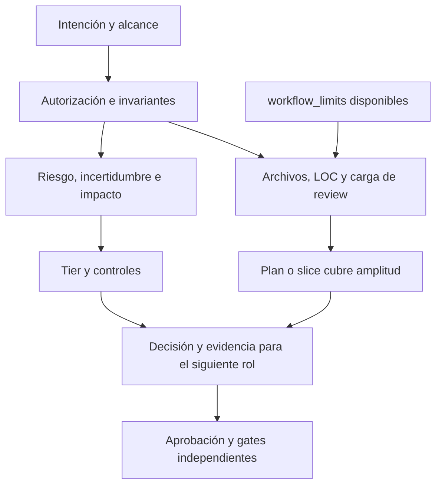

# Diseño: decisiones proporcionales coherentes

## Contexto y objetivo del LLM

Aplicar el bloque 1 del informe comparativo con `Gentleman-Programming/gentle-ai` sin introducir una metodología adicional. El outcome esperado es que Codex aplique decisiones coherentes de riesgo, workload y permisos en Lufy. Ningún ahorro se considera demostrado por este change. Por instrucción explícita del usuario, OpenCode y Pi no son superficies de mejora ni alternativas de migración de este plan.

El análisis inicial identificó estas dependencias:

- Specs vigentes: `sdd-harness-routing` y `systemic-workflow`.
- Política canónica: `.lufy/contracts/delivery.md`.
- Roles neutrales existentes: referencia de límites y responsabilidades, sin cambios en este scope Codex.
- Consumidores: agentes Codex y superficies compartidas pertinentes; sin propagación a OpenCode.
- Distribución: `internal/assets/embedded/`, con paridad exigida por ADR 0001.
- Evidencia: tests de assets protegen presencia de instrucciones; no ejecutan un modelo.

## Arquitectura y componentes

No se crea un motor de clasificación, un rol nuevo ni un nuevo schema. La arquitectura actual de roles y adapters permanece. El contrato neutral define la semántica y Codex la consume mediante sus agentes, conservando mecanismos y permisos. No se reclama equivalencia conductual de adapters ajenos al alcance.

## Decisiones

### D1. Separar clasificación de workload

Tier sigue determinado por riesgo, incertidumbre, impacto y tipo de cambio. Los recuentos informan carga, revisión y recuperabilidad del bloque; no prueban riesgo por sí mismos.

Un T3 puede necesitar una decisión de workload sin convertirse automáticamente en Full. Si la inspección descubre comportamiento incierto o riesgo, se eleva el tier por esa evidencia, no por la cifra aislada.

### D2. Mantener checkpoints, aclarar su función

- Cuatro archivos significativos: comprobar que plan/slice cubre la amplitud. Si no hay cobertura o aparece alcance nuevo no cubierto, pausar y resumir en la frontera segura.
- Cinco archivos estimados: router explicita decisión de workload y necesidad de slices. Si dividir no reduce carga o fragmenta un cambio mecánico, documentar una única unidad con justificación.
- LOC y review budgets: usar únicamente configuración canónica disponible. Nunca inventar valores efectivos desde defaults de generación.

No se modifican defaults numéricos. Una regla configurada que requiere pausa sigue requiriéndola.

### D3. Definir archivo significativo sin ocultar review

Es significativo un archivo cuyo cambio requiere una decisión sustantiva de comportamiento, aceptación, contrato, configuración operacional o instrucciones del harness. Ser documental no lo excluye: una política de seguridad es significativa. Una sustitución mecánica demostrablemente equivalente no adquiere riesgo sólo por repetirse.

Fuentes y mirrors sincronizados representan una misma decisión lógica, pero ambos permanecen visibles en diff, paridad y recuentos Git de review. No se excluyen mirrors del assessment ejecutable ni se simula menor churn.

### D4. Precedencia de restricciones

1. Alcance y autorización explícitos del usuario, dentro de los invariantes de seguridad/permisos del harness.
2. Gates independientes: aprobación post-plan, seguridad, contratos, validación y delivery. Ninguna señal de workload los concede.
3. `workflow_limits` disponibles para límites configurables de sizing, routing, review, slicing, preflight y stop rules.
4. Checkpoints declarados del harness, también cuando falta configuración. Se etiquetan como guardrails del harness, no como configuración leída.

Las restricciones se combinan conservadoramente: un plan existente puede satisfacer cobertura de amplitud, pero no puede desactivar una stop rule ni sustituir una aprobación. Configuración inválida o ambigüedad con consecuencias exige diagnóstico/decisión, no continuidad optimista.

### D5. Evidencia y contexto compacto

Reutilizar el plan, IDs de aceptación, paths y fuentes de límites ya recibidos. Reabrir exploración sólo si cambian alcance, evidencia o riesgo. No añadir campos públicos al Result Contract: usar los campos existentes y notas de evidencia para explicar decisión y cobertura.

## Datos y persistencia

Sin migraciones, almacenamiento nuevo ni cambios de formato. Artefactos del change permanecen separados de memoria y ledger. La configuración ausente no se crea como efecto lateral. No se guardan prompts, diffs ni contenido de conversación en el ledger.

## Seguridad y permisos

Orquestador continúa sin edición/shell. Implementer continúa sin delivery. Se mantienen controles de auth, configuración sensible, contratos públicos y operaciones destructivas. `auto-chain`, `next_recommended`, un plan o un budget satisfecho no equivalen a autorización.

## Operación y distribución

Actualizar sólo archivos afectados y mirrors exactos; no copiar directorios completos ni changes activos al catálogo embebido. Revisar templates y referencias compartidas antes del cierre para evitar reglas viejas contradictorias.

No ejecutar install/sync contra este repositorio para aplicar la propuesta. Esos comandos pueden mutar estado gestionado no relacionado.

## Matriz mínima de evaluación

| Caso | Resultado esperado | Prohibido |
| --- | --- | --- |
| Ocho archivos con sustitución mecánica sin riesgo | Tier proporcional y workload justificado | Full por recuento aislado |
| Una línea de auth runtime | Router y al menos T2; fast path false | T3 por tamaño |
| Cuatro significativos con plan suficiente | Registrar cobertura; seguir con gates restantes | Repetir aprobación sólo por recuento o saltar gate previo |
| Cuatro significativos sin plan | Pausa segura y plan requerido | Escritura amplia silenciosa |
| Cinco estimados mecánicos | Decisión de workload; una unidad si se justifica | Slices artificiales obligatorios |
| Config ausente | not_available y guardrails explícitos | Budget inventado |
| Plan cubierto más stop rule activa | blocked/escalated y recovery | Usar plan para ignorar stop rule |
| Cambio en fuente y mirror | Misma decisión lógica, diff real completo | Excluir mirror del review ejecutable |
| auto-chain sin aprobación post-plan | Esperar aprobación requerida | Interpretar metadata como permiso |

La matriz guía revisión estática y el futuro piloto; no se denomina benchmark ni evaluación de un LLM ejecutada.

## Pruebas y validación

- Capturar primero regresiones de contrato que detecten instrucciones contradictorias en las superficies afectadas; indicar que son pruebas textuales/de paridad.
- Mantener `TestAgentAssetsContainT2FastPathApprovalGate`, controles de seguridad y `TestEmbeddedCatalogMatchesRepositoryAssets`.
- Agrupar tests de assets/instructions/core y validación completa al final de S2, salvo diagnóstico o cambio riesgoso.
- Ejecutar `scripts/validate.sh` según el alcance real y construir `tools/lufy-cli-go/bin/lufy-ai` cuando cambien assets distribuidos.
- Validar este change con `openspec validate clarify-proportional-workflow-decisions --strict` cuando el CLI esté disponible.
- Usar chequeo whitespace con base de PR si se prepara delivery; sin autorización no ejecutar commit/push/PR.

## Trade-offs y alternativas

- Reemplazar SDD por ODD: descartado; duplicaría mecanismos sin evidencia de mejora.
- Reducir límites o quitar aprobaciones: fuera de alcance; son decisiones de política distintas.
- Crear clasificador determinista: fuera de alcance; necesita contrato y evaluación propios.
- Uniformar todos los números: descartado; checkpoints de amplitud y presupuestos de review no son el mismo mecanismo.
- Abrir permisos inline: descartado en este bloque; altera arquitectura y fronteras de responsabilidad.

## Rollback

Los cambios futuros serán instrucciones/docs/tests acotados y sus mirrors. Revertir sólo el slice afectado, sin restaurar directorios completos, borrar estado local o modificar trabajo ajeno. Mantener evidencia del motivo del rollback. No hay rollback de datos ni migración necesaria.
